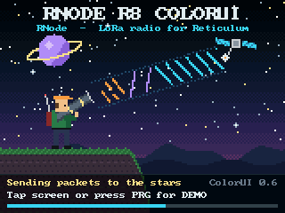
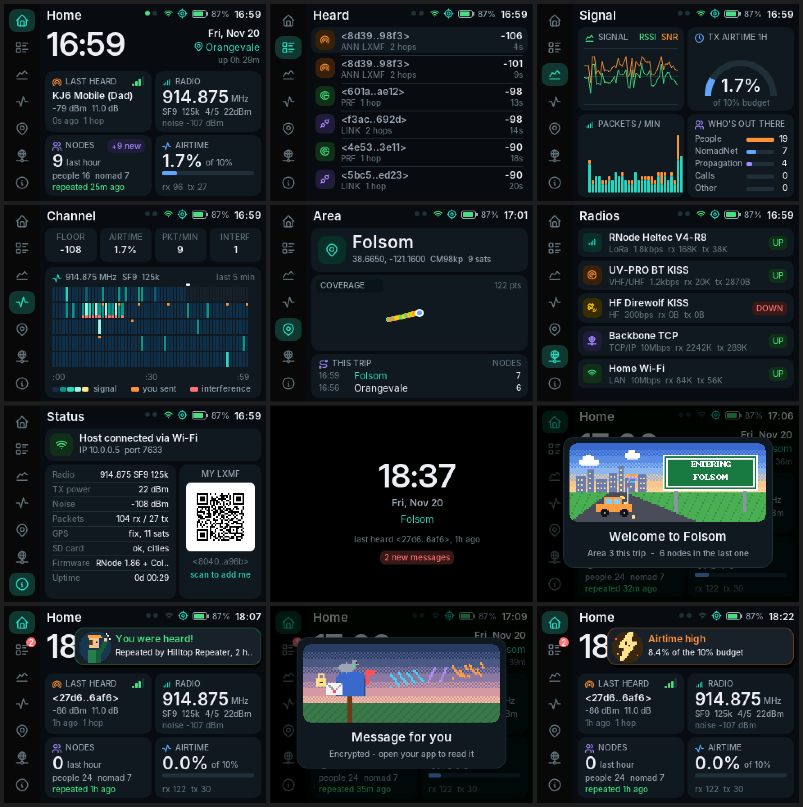

# RNode R8 ColorUI

A full-color, touch-screen RNode for the **Heltec WiFi LoRa 32 V4-R8 + Expansion
Kit V2** (2.8" 320x240 touch screen, micro-SD, GNSS).

The radio side is the official RNode firmware 1.86 with a few small hooks, so the
board is a normal RNode to Reticulum (MeshChatX, Sideband, NomadNet, rnsd). The
screen is a separate core that only *watches* the traffic: who's out there, how
strong they are, what kind of packets, the channel's noise, and where you are.



> **Status: 0.7 (modern UI).** 0.6 ran on real hardware (provisioned, linked up in
> MeshChatX over USB and Wi-Fi). 0.7's new screens are rendered by the same code
> in the simulator and build cleanly for the R8; first hardware run pending.
> Unofficial community build, not a release from the RNode project.



## What you get

- **Modern UI**: dark cards, smooth Inter text, Tabler icons, a status bar (live
  RX/TX, USB / Wi-Fi / Bluetooth link, GPS, battery, clock) and a left icon rail.
  Tap a rail icon to jump to a page, swipe to flip, long-press for privacy.
  Themes: `night` (teal), `soft` (blue), `amber`, and `retro` (the 0.6 pixel look).
- **7 pages**: Home (clock, last heard, radio, nodes, airtime), Heard, Signal,
  Channel waterfall, Area (town, coverage map, trip), Radios (host interfaces),
  Status (connection + Wi-Fi IP, details, **QR code of your LXMF address**).
- **You were heard!** When another node repeats your own announce, you get a toast
  and Home shows when it last happened: proof your signal gets out.
- **Coverage map**: every packet heard with a GPS fix becomes a colored dot
  (green = strong, red = weak) on the Area page, over offline map tiles if the SD
  card has them, and goes into a CSV log.
- **Airtime warning** at 8 % of the 10 %/hour budget.
- **Screensaver**: after 5 idle minutes a drifting clock with the backlight dimmed;
  a message or new town wakes it.
- **SD card**: settings, nicknames, your own splash pictures, offline map, logs
  ([docs/SD_CARD.md](docs/SD_CARD.md), examples in `sd-card-example/`).
- **12 boot splashes**, one per boot in rotation. Six comics (UFO abduction, roof
  install, solar box, balloon, fishing...) and six that sneak in real RF physics:
  LoRa up/down chirps, Fresnel zone clearance, SF12 decoding at -20 dB SNR, +6 dB =
  double the distance, cross-polarization loss, Yagi gain.
  
- **Graphic notifications**: new message for you, "Welcome to <city>" as you drive
  in, new node heard, host linked/lost, GPS fix/lost, interference, low battery.
  Full-screen cards for the big ones, toasts for the rest
  ([docs/NOTIFICATIONS.md](docs/NOTIFICATIONS.md)).
  
- **City locator** using the WADAMESH `cities.bin` format (offline, nothing
  transmitted; see [SD card](#sd-card-city-locator)).
- **DEMO mode**: tap the screen or press PRG during the splash to replay real
  Reticulum traffic and a pretend drive, without any radio partner.
- **PA + LNA front end on** (KCT8103L, 21 dB LNA gain corrected out of RSSI), PSRAM-safe
  pins for the R8 (GPIO 33-37 are octal PSRAM and are never touched).

It reads only what Reticulum sends in the clear (packet type, hops, hashes,
announce names). Message contents stay end-to-end encrypted; it never shows them.

## Hardware

Only the **V4-R8** (V4.3, 8 MB octal PSRAM, 16 MB flash) in the **Expansion Kit V2**.
Do **not** flash this on a plain V4 (R2): different pins.

> **Never run `rnodeconf --autoinstall` on an R8.** It only knows the plain V4 and
> installs firmware that drives the R8's PSRAM pins.

## Install

### Option A: prebuilt files (GitHub Releases)

Every release has `rnode-r8-colorui-FULL.bin`, `firmware.bin` and `FIRMWARE_HASH.txt`,
built by GitHub Actions from this repo.

1. Back up what's on the board (optional but smart):
   `esptool --chip esp32s3 --port PORT read-flash 0 0x1000000 backup.bin`
2. Download mode: hold **PRG**, tap **RST**, let go of PRG.
3. Flash:
   - **First install** (erases the RNode settings too):
     `esptool --chip esp32s3 --port PORT --baud 921600 write-flash 0x0 rnode-r8-colorui-FULL.bin`
   - **Upgrade** (keeps provisioning):
     `esptool --chip esp32s3 --port PORT --baud 921600 write-flash 0x8000 partitions.bin 0x10000 firmware.bin`
     (0.7 uses a 6 MB app slot; `partitions.bin` moves to it without touching the
     RNode's saved settings at 0x9000)
4. Press **RST**, then [provision / register the hash](#make-it-an-rnode).

PORT is `COM5` etc. on Windows, `/dev/ttyACM0` on Linux, `/dev/cu.usbmodem...` on a Mac.
On Windows use `py -m esptool` if `esptool` isn't on your PATH.

### Option B: build it yourself (PlatformIO)

```
pip install platformio rns
cd firmware
pio run -e heltec_v4_r8_colorui                 # build
pio run -e heltec_v4_r8_colorui -t upload       # flash + register the firmware hash
```
`firmware/` is a ready-to-build project: RNode 1.86 with ColorUI applied. Edit the
sources in `core/` and `device/`, then `python3 tools/sync_firmware.py` to copy them in.

**Your own name on the splash:** put `brand = My Reticulum Box` in `settings.ini`
on the SD card (or build with `'-DCOLORUI_BRAND="MY RETICULUM BOX"'`).

## Make it an RNode

First time only, give the board its R8 identity:
```
pip install rns
rnodeconf --key
rnodeconf PORT --rom --product cb --model c8 --hwrev 1
```
Then, after **every** flash, register the hash of the firmware you flashed:
```
py tools/pc/rnode_sethash.py PORT <hash from FIRMWARE_HASH.txt>
```
(PlatformIO's upload step does this for you.) Why not
`rnodeconf --firmware-hash`? On the ESP32-S3's native USB, closing the serial port
resets the board, and rnodeconf closes it before the board finishes saving. You end up
with a hash of `ffff...` and Reticulum refuses the radio with **"Radio state mismatch"**.
`rnode_sethash.py` keeps the port open until the save is done, then checks it.

`rnodeconf PORT --info` may print a KeyError for product `0xCB`; that's cosmetic
(rnodeconf doesn't know the R8 product ID). The custom ID is deliberate: it stops
plain-V4 firmware from being installed on the R8 by mistake.

## Use it with Reticulum

Add under `[interfaces]` in `~/.reticulum/config` (or MeshChatX: Interfaces -> Add
Interface -> RNode):
```
  [[R8 RNode]]
    type = RNodeInterface
    enabled = yes
    port = COM5
    frequency = 914875000
    bandwidth = 125000
    txpower = 17
    spreadingfactor = 9
    codingrate = 5
```
Every RNode that should hear each other needs the same frequency, bandwidth, SF and CR.
Pick values that are legal where you are.

### Over Wi-Fi instead of USB

RNode 1.86 can join your Wi-Fi (2.4 GHz only) and Reticulum connects over TCP port 7633.
Close anything using the serial port, then:
```
py tools/pc/rnode_wifi.py COM5 "WiFi name" "WiFi password"
```
(Use this, not `rnodeconf --ssid/--psk`: same port-close reset problem as the hash.)
Find the board's IP in your router (hostname `RNodeXXXX`) and set
`port = tcp://<that IP>` in the interface. Reserve the IP in your router so it
doesn't change. `rnode_wifi.py COM5 --off` turns Wi-Fi off again.

Optional: `host/ColorUIRNodeInterface.py` is a drop-in interface for rnsd that also
tells the screen which destinations are *yours* ("Message for you" cards) and shows
the host's other interfaces. See [docs/HOST_PROTOCOL.md](docs/HOST_PROTOCOL.md).

### Troubleshooting

| Symptom | Fix |
|---|---|
| "Radio state mismatch" | Firmware hash not saved. Run `tools/pc/rnode_sethash.py` (above). |
| MeshChatX shows the RNode **Link down** after "Restart RNS", log says `could not open port ... Access is denied` | The in-app restart keeps the old port open. Quit MeshChatX completely (X -> Quit application) and start it again. |
| Endless `multicast` errors from AutoInterface on Windows | A Wi-Fi Direct virtual adapter. Add its GUID to `ignored_devices` under `[[Default Interface]]`. |
| Status page says SD "no valid FAT volume" | Card isn't FAT32. See below. |
| Board resets every time a program closes the port | Normal for the ESP32-S3's native USB. |

`tools/pc/` has read-only helpers: `capture_serial.py` (boot log that survives
resets) and `rnode_diag.py` (asks the board for its hashes and radio state).

## SD card

Full list of files: [docs/SD_CARD.md](docs/SD_CARD.md). City locator:

1. Format a micro-SD card **FAT32**. Windows only formats FAT32 up to 32 GB; for a
   bigger card, run in an **Administrator** PowerShell (wipes the card in D:):
   `$n=(Get-Partition -DriveLetter D).DiskNumber; Clear-Disk $n -RemoveData -Confirm:$false; Initialize-Disk $n -PartitionStyle MBR; New-Partition -DiskNumber $n -Size 31GB -DriveLetter D | Format-Volume -FileSystem FAT32`
2. Download your state's file from the
   [WADAMESH city-locator release](https://github.com/Languskhan/wadamesh/releases)
   (for example `cities-california.bin`), or build one with `tools/make_cities.py`
   from Census TIGER/Line place files.
3. Rename it to **`cities.bin`** and put it in the card's top folder. Max 4 MB.
4. Insert the card and reset the board. Status shows "ok, cities.bin"; with a GPS fix,
   crossing into a town pops up "Welcome to ...".

## Simulator (no hardware)

```
pip install rns lxmf msgpack pillow
make shots      # every page, rendered from real Reticulum packets -> sim/out/png/
make splash     # all boot splashes -> sim/out/splash/
THEME=retro make shots   # other themes: soft, amber, retro
```

## Layout

```
core/       display core, plain C++ (same code on device and PC)
device/     ESP32 glue (LovyanGFX, touch, GPS, SD, buzzer) + RNode patch tools
firmware/   ready-to-build PlatformIO project (RNode 1.86 + ColorUI)
host/       ColorUIRNodeInterface.py for rnsd + protocol helper
sim/        PC simulator and trace generator
tools/      art/splash/popup generators, make_cities.py, sync_firmware.py, pc/ helpers
docs/       SD card, notifications, host protocol, radios, design notes
sd-card-example/  settings.ini and names.txt to start from
```

## License and credits

GPLv3, as a fork of Mark Qvist's [RNode firmware](https://github.com/markqvist/RNode_Firmware).
Unofficial community build; not supported by the RNode project.

- City locator, touch handling, Expansion Kit V2 display/SD/GPS pins:
  [WADAMESH](https://github.com/Languskhan/wadamesh) (GPLv3).
- R8 board IDs, PSRAM-safe peripheral pins, battery calibration, Q-bar and waterfall
  ideas: Nickie Deuxyeux's community RNode fork (git.rns.moscow/deuxyeux/RNode_Firmware, GPLv3).
- 8x8 font: dhepper/font8x8 (public domain). Inter font: Rasmus Andersson (SIL OFL 1.1).
- Icons: Tabler Icons (MIT). QR codes: Project Nayuki QR Code generator (MIT).
- Modern UI layout inspired by Cairn (cvhviz/CAIRN) and WADAMESH.
- Place boundaries: US Census TIGER/Line (public domain).
